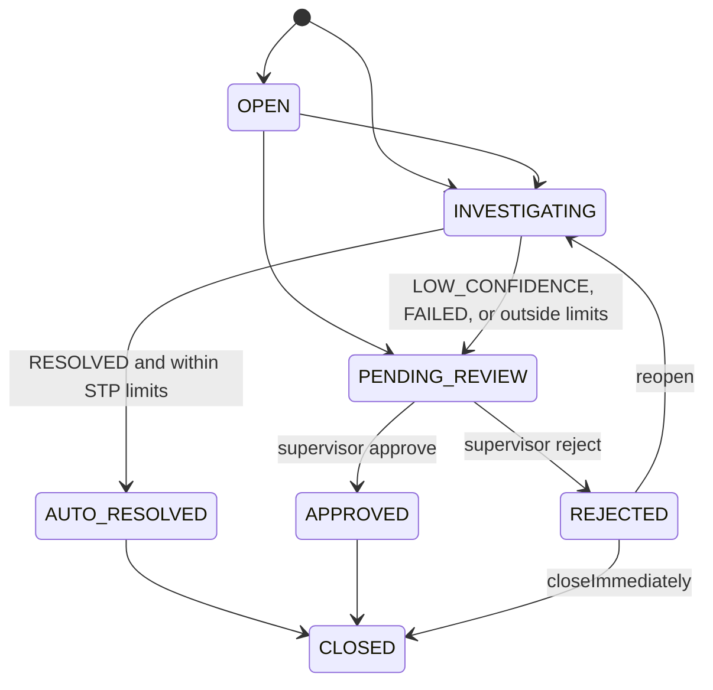

# Resolution Service — Phase 5

The resolution service accepts Phase 4 investigation results, applies the
straight-through processing (STP) rules, records case-state transitions, and
provides supervisor review operations.

## Workflow finite state machine



The Phase 4 callback starts an `OPEN` case's investigation before applying the
result. Repeated callbacks for a case already past `OPEN`/`INVESTIGATING` are
acknowledged without adding transitions, making Phase 4's at-least-once
delivery safe to retry.

### STP thresholds

The rule engine auto-resolves only `RESOLVED` results with cited evidence when
both the canonical discrepancy amount and the case anomaly score are within
their configured limits. Other outcomes go to `PENDING_REVIEW`.

| Property | Default | Meaning |
| --- | ---: | --- |
| `reconiq.stp.max-auto-resolve-amount` | `10.00` | Maximum discrepancy amount for automatic resolution |
| `reconiq.stp.max-anomaly-score` | `0.75` | Maximum anomaly score for automatic resolution |

Set these Spring properties in `application.properties`, environment-backed
configuration, or command-line arguments to override the defaults. The
comparison includes the configured boundary (`<=`).

## HTTP API

All routes are rooted at `/api/v1/workflows`:

| Method | Endpoint | Purpose |
| --- | --- | --- |
| `POST` | `/rca-callback` | Receive a Phase 4 investigation result and process the workflow |
| `POST` | `/{caseId}/approve` | Approve a pending case with a reviewer, action, and optional notes |
| `POST` | `/{caseId}/reject` | Reject a pending case; `closeImmediately` determines whether it also closes |
| `POST` | `/{caseId}/reopen` | Move a rejected case back to `INVESTIGATING` |
| `GET` | `/{caseId}/history` | Return the current snapshot and chronological transition audit entries |

The callback uses the Phase 4 `InvestigationResult` JSON contract
(`schema_version`, `case_id`, `source_phase`, `transaction_ids`, `status`,
`root_cause`, evidence references, failure details, attempts, model, and
timestamp). For example:

```json
{
  "schema_version": 1,
  "case_id": "case-123",
  "source_phase": "PHASE_3",
  "transaction_ids": ["TXN-1"],
  "status": "RESOLVED",
  "root_cause": "Duplicate transaction",
  "cited_evidence": [{"kind": "transaction", "ref_id": "TXN-1"}],
  "examined_evidence": [{"kind": "transaction", "ref_id": "TXN-1"}],
  "failure_reason": null,
  "attempts": 1,
  "model": "investigator",
  "investigated_at": "2026-11-21T20:00:00Z"
}
```

## Phase 4 callback configuration

Phase 4 posts completed results to the URL in `PHASE5_RESULT_URL`. Point it at
this service's callback endpoint; for a local service on the default port:

```dotenv
PHASE5_RESULT_URL=http://localhost:8085/api/v1/workflows/rca-callback
```

This setting belongs to Phase 4's environment (see `ai-service/.env.example`).
The resolution service listens on port `8085` by default.

## Persistence ports and Person B's JPA adapters

The workflow depends on three domain ports in `com.reconiq.resolution.port`:

* `CasePersistencePort` loads the case snapshot by case ID and saves each new
  state. Person B's JPA adapter should implement it by mapping the case entity
  to/from `CaseSnapshot` and delegating lookup/save to the case repository.
* `ResolutionHistoryPort` appends `TransitionRecord` entries and fetches them
  by case ID. Its JPA adapter should persist each transition in the history
  repository and return the case's entries for chronological history responses.
* `CanonicalAmountPort` looks up the canonical discrepancy amount for a list
  of transaction IDs. Its JPA adapter should query the canonical transaction
  repository and return the computed discrepancy as `Optional<BigDecimal>`.

These are adapter contracts: the service calls the ports rather than JPA
repositories directly. In the current service source, conditional in-memory
fallback adapters are provided for case and history storage; the in-memory
amount adapter intentionally has no seeded data. When Person B supplies JPA
adapter beans for all three ports, Spring's `@ConditionalOnMissingBean`
fallback configuration allows those beans to replace the in-memory defaults.

## Tests

Run the service test suite from this directory:

```powershell
mvn test
```

`ResolutionWorkflowIntegrationTest` boots the Spring application and sends
HTTP requests through MockMvc. It covers low-amount auto-resolution and
duplicate-callback idempotency, supervisor approval with complete transition
history, and rejection followed by reopening for investigation.
